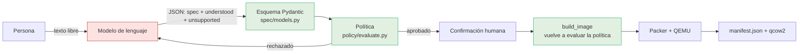
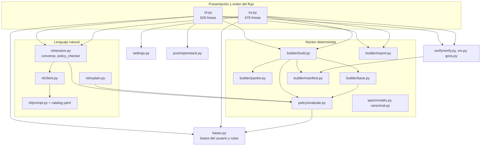
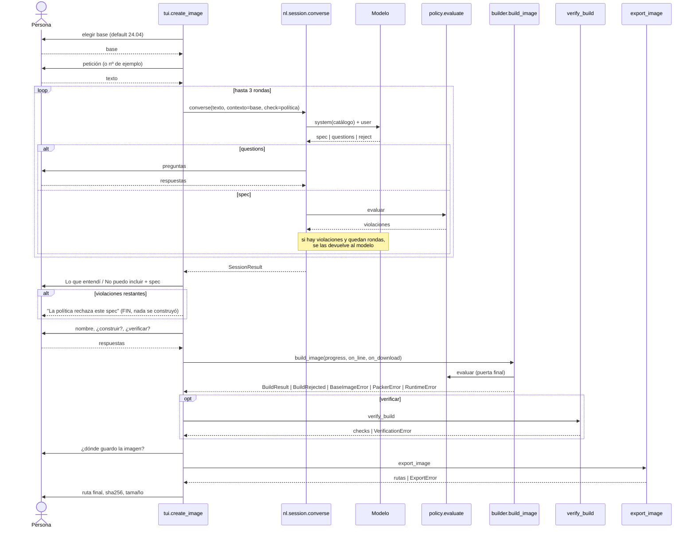
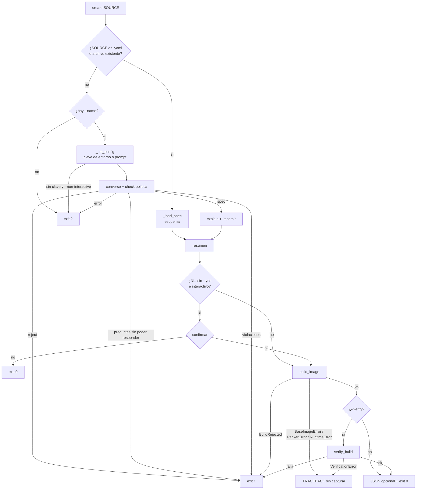
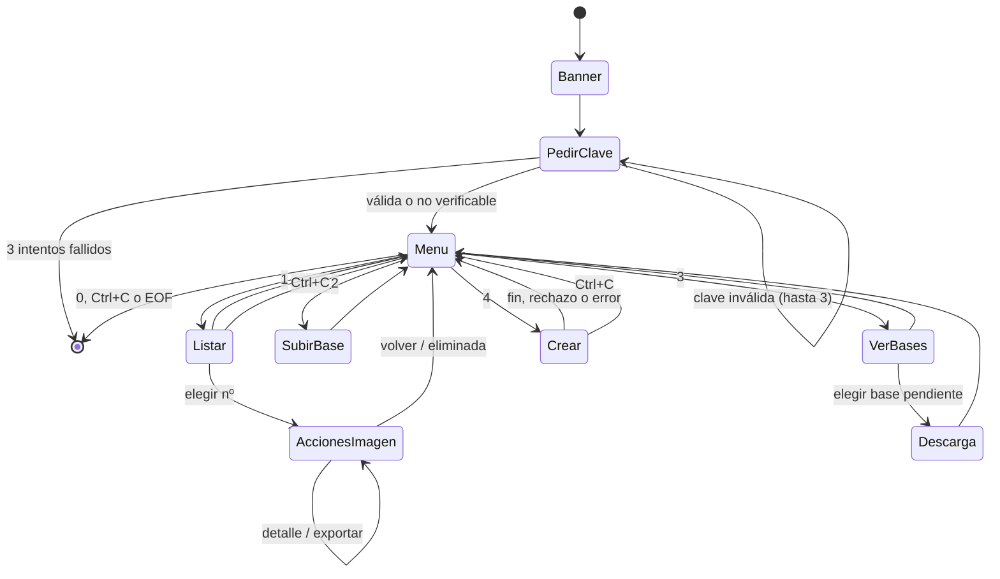

# Flujo de control de gira-iso

Estado: **P0 y P1 cerradas**. Las secciones 1 a 8 describen el código tal como estaba en P0 (commit `60e43e0`); donde P1 lo cambió, se indica. Este documento responde: *¿quién decide qué, en qué orden, dónde se puede parar todo y qué pasa cuando algo
falla?* La sección 9 resume los problemas encontrados; el plan para resolverlos está en la sección 10.
Cuando cada fase se complete, las secciones se actualizan al estado nuevo (ver sección 10).

Convención: el código, los identificadores y los comentarios están en inglés; este documento, en español.

---

## 1. Principio de confianza

Todo el diseño descansa en una idea: **el modelo de lenguaje nunca ejecuta nada ni decide qué es
seguro**. Solo propone un spec declarativo; lo que lo deja pasar es código determinista.

| Pieza | Puede | No puede |
|---|---|---|
| Modelo (`nl/`) | Proponer un spec, preguntas o un rechazo | Escribir scripts, URLs, repositorios; ampliar la lista de paquetes |
| Esquema (`spec/models.py`) | Rechazar formas inválidas (campos extra, tamaños, nombres) | Decidir qué paquetes son seguros |
| Política (`policy/`) | Rechazar paquetes, servicios, rutas y bases fuera de la lista | Nada con red ni con el sistema de archivos (función pura) |
| `build_image` | Volver a evaluar la política (segunda puerta, independiente del modelo) y construir | Aceptar un spec que no pasó |
| Packer/QEMU | Ejecutar la plantilla renderizada | Leer nada que no esté en la plantilla |

La política se evalúa **tres veces** en el camino de "crear" desde lenguaje natural: dentro de la
conversación (para que el modelo se corrija), en la vista previa y, de forma obligatoria, dentro de
`build_image`. Solo la última es una garantía; las otras mejoran la experiencia.

---

## 2. Mapa de módulos

**Hoy no hay una regla de dependencias escrita.** `cli.py` y `tui.py` importan directamente al núcleo y
*cada uno* decide el orden de los pasos (hallazgo H1).

---

## 3. Flujo "crear" por el menú (`tui.create_image`)

Puntos donde la persona puede detener el flujo: elegir base, petición vacía, preguntas del modelo (no
responder no es posible: hay que contestar o `Ctrl+C`), nombre inválido, "¿construir?", y `Ctrl+C` en
cualquier momento (vuelve al menú).

## 4. Flujo "crear" por el CLI (`cli.create`)

Mismas fases, orden distinto y con otras decisiones:

### Diferencias entre los dos caminos

| Aspecto | Menú | CLI |
|---|---|---|
| Nombre de la imagen | se pide **después** de interpretar | `--name` obligatorio **antes** |
| Base | se elige en una lista; el modelo no decide | la decide el modelo (por defecto 24.04) |
| Vista previa del spec | siempre | solo con lenguaje natural y sin `--yes` |
| Exportar a una carpeta | sí, al final | no (hay `download` aparte) |
| Errores de build | capturados (`BaseImageError`, `PackerError`, `RuntimeError`, `KeyboardInterrupt`) | solo `BuildRejected`; el resto es **traceback** |
| Longitud máxima del nombre | 63 (`tui.NAME_RE`) | 64 (`cli._IMAGE_NAME`) |
| Spec desde archivo | no | sí |

---

## 5. Máquina de estados del menú

La clave de API vive solo en memoria (`LlmConfig`); no se escribe en disco ni en logs. Lo único que se
recuerda entre ejecuciones es el último nombre y destino (`settings.py`).

---

## 6. Errores: quién los lanza y quién los captura

| Excepción | La lanza | `cli create` | Menú |
|---|---|---|---|
| `BuildRejected` | `builder/build.py` | exit 1 | tabla de violaciones |
| `BaseImageError` | `builder/base.py` | **traceback** | mensaje |
| `PackerError` | `builder/packer.py` | **traceback** | panel "Falló la construcción" |
| `RuntimeError` (directorio existe, Packer sin imagen) | `builder/build.py` | **traceback** | panel |
| `VerificationError` | `verify/verify.py` | **traceback** | mensaje |
| `VmError` | `verify/vm.py` | se convierte en un check fallido dentro de `verify_build` (parcial) | igual |
| `InterpretError` | `nl/client.py` | capturada en `converse` → exit 2 | mensaje |
| `ExportError` | `builder/export.py` | `download`/`delete`: exit 2 o 1 según `.invalid` | mensaje |
| `UserBaseError` | `bases.py` | (no aplica) | mensaje |
| `PushError` | `push/openstack.py` | `push`: exit 2 | (no aplica) |
| `KeyboardInterrupt` | — | **traceback** | vuelve al menú; Packer se termina |

Todas heredaban de `RuntimeError` **sin una raíz propia**, y el código de salida lo elegía cada comando a
mano (42 usos de `typer.Exit` en `cli.py`).

> **Desde P1:** todas heredan de `errors.GiraError`, que lleva su `exit_code`; cada comando del CLI
> está envuelto por `_guarded`, que convierte cualquier `GiraError` en `error: …` más su código y
> `Ctrl+C` en el código 130. Ya no hay trazas en `create`, `build` ni `verify`. Los códigos por clase:
> `BuildRejected` 1 · `ExportError` 2 si la entrada es inválida y 1 si se rechazó · `BaseImageError`,
> `PackerError`, `VmError`, `BuildError` 3 · el resto 2.

Contrato de salida documentado en el README: `0` éxito · `1` el motor o la verificación rechazaron algo
(o el modelo necesita más detalle) · `2` entrada inválida. El código `3` (fallos de entorno) y el `130` (interrumpido) se añadieron en P1; el chequeo previo que
anticipa esos fallos llega en P3 (C4).

---

## 7. Ciclo de vida de los artefactos

| Artefacto | Nace | Vive en | Se borra |
|---|---|---|---|
| API key | al pedirla / variable de entorno | memoria del proceso | al salir |
| Preferencias (último nombre/destino) | tras exportar en el menú | `~/.local/share/gira-iso/settings.yaml` | nunca |
| Base oficial descargada | primer uso o desde el menú | `~/.cache/gira-iso/images/` | nunca (hay que borrarla a mano) |
| Descarga parcial `*.part` | durante la descarga | junto a la base | se renombra al verificar; **queda huérfana si se interrumpe** |
| Base subida por el usuario | opción 2 | `~/.local/share/gira-iso/bases/` | nunca |
| Directorio de build | `build_image` | `~/.local/share/gira-iso/builds/<fecha>-<hash>/` | con `delete`; **un build fallido queda** |
| Clave SSH del build `id_ed25519` | `build_image` | dentro del directorio de build | **nunca** (ver H7 y H8) |
| Plugin de Packer | `packer init` | `~/.packer.d/` | nunca |
| Imagen y manifest | build correcto | `builds/<id>/image/` y `manifest.json` | con `delete` |
| Copia exportada | menú o `download` | carpeta elegida | a mano |

Un directorio sin `manifest.json` no se lista (`scan_builds` lo ignora), por lo que los builds fallidos
son invisibles pero siguen ocupando disco y conservando la clave privada.

---

## 8. Controles que existen hoy

| Control | Dónde | Qué evita |
|---|---|---|
| Esquema cerrado (`extra="forbid"`) | `spec/models.py`, `nl/schema.py` | campos inventados por el modelo |
| Política como segunda puerta | `build_image` | spec que no pasó, aunque la UI lo permitiera |
| Verificación de sha256 de la base | `builder/base.py` | base alterada o descarga corrupta |
| Base registrada: solo qcow2, nunca ISO | `bases.py` | instalador usado como base |
| Autocorrección acotada (3 rondas) | `nl/session.py` | bucles infinitos con el modelo |
| Claims del modelo verificados | `nl/explain.py` | explicaciones que contradicen el spec |
| Borrado solo bajo `builds/`, sin symlinks | `builder/export.delete_build` | borrar fuera del área de trabajo |
| Terminar Packer con `Ctrl+C` | `builder/packer.py` | VM huérfana |
| Limpieza de la imagen (machine-id, claves de host, cloud-init) | `templates/scripts/cleanup.sh.j2` | imágenes que heredan estado del build |
| Validación de la clave de API | `nl/client.check_credentials` | descubrir una clave mala al final |

---

## 9. Hallazgos

Verificados leyendo el código; H7 requiere confirmarse con un build real.

| # | Hallazgo | Gravedad | Estado |
|---|---|---|---|
| H1 | El flujo "crear" está duplicado en `cli.create` y `tui.create_image`; cada uno decide el orden | alta (mantenimiento) | pendiente (P2) |
| H2 | 10 clases de error sin raíz propia; el código de salida lo elige cada comando | media | **resuelto en P1**: `errors.GiraError` con `exit_code` |
| H3 | Dos reglas de nombre de imagen (63 vs 64 caracteres) | baja | **resuelto en P1**: `naming.py` (64 caracteres) |
| H4 | Progreso por tres callbacks sueltos en vez de eventos tipados | media | pendiente (P2) |
| H5 | `cli.py` (629) y `tui.py` (678) mezclan argumentos, presentación, flujo y comandos avanzados | media | pendiente (P2) |
| H6 | Lectura de manifests triplicada (`cli._load_manifest`, `verify.load_manifest`, `export.scan_builds`) | baja | **resuelto en P1**: `builder/catalog.py` |
| H7 | El usuario de build `packer` (sudo NOPASSWD + clave pública del build) se crea por cloud-init y la limpieza no lo elimina; la clave privada queda en el directorio de build. Si se confirma, **toda imagen producida acepta esa clave** | **alta (seguridad)** | pendiente (P3, C1) |
| H8 | Un build fallido o cancelado deja el directorio con la clave privada; no hay forma de limpiar huérfanos | alta | pendiente (P3, C2) |
| H9 | Sin candado: dos builds iguales en el mismo segundo chocan con `RuntimeError` | baja | pendiente (P3, C3) |
| H10 | Sin preflight: QEMU, KVM o espacio faltantes se descubren dentro de Packer | alta (experiencia) | pendiente (P3, C4) |
| H11 | Sin timeout global del build; una descarga interrumpida deja un `.part` | media | pendiente (P3, C5 y C6) |
| H12 | `cli create` y el comando `build` solo capturan `BuildRejected`: un fallo de Packer, de checksum o de verificación termina en traceback | alta | **resuelto en P1**: guarda `_guarded` en todos los comandos |

---

## 10. Hacia dónde va

El plan aprobado ordena el trabajo en fases con un commit cada una:

1. **P0** este documento.
2. **P1** base común: `errors.py` (raíz `GiraError` con código de salida), `naming.py`, `builder/catalog.py`.
3. **P2** un solo orquestador `workflow/create.py` con eventos tipados y un puerto `Io`; `cli/` y `tui/`
   pasan a ser adaptadores que solo presentan y responden.
4. **P3** controles: C1 eliminar el usuario de build, C2 borrar la clave en `finally` y `gira-iso clean`,
   C3 candado, C4 preflight, C5 cancelación limpia, C6 timeout global, y código de salida `3` para
   fallos de entorno.
5. **P4** este documento actualizado al estado final.

Cada fase se registra en el log de [`plan-v1.md`](plan-v1.md) al cerrarse.
