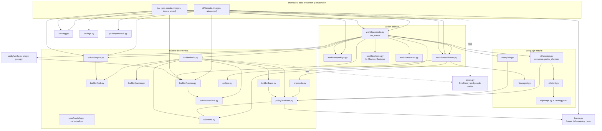
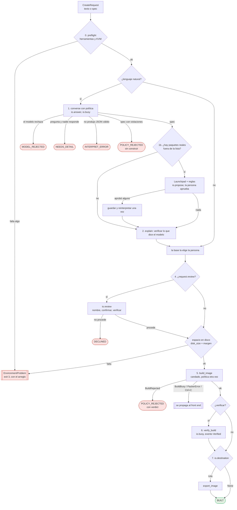
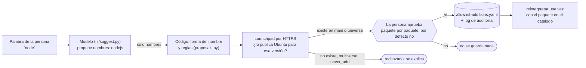
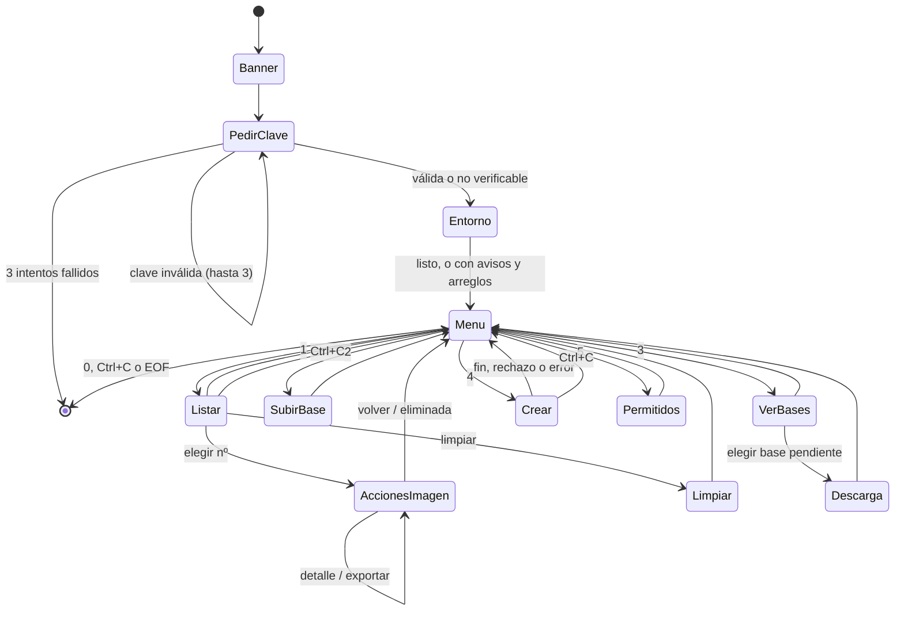

# Flujo de control de gira-iso

Estado: **P0 a P4 cerradas, C1 confirmado con un build real, y la lista permitida ya se puede ampliar** (flujo de control, ver el log de [`plan-v1.md`](plan-v1.md)). Este documento
describe el código tal como está y responde: *¿quién decide qué, en qué orden, dónde se puede parar todo
y qué pasa cuando algo falla?*

Convención: el código, los identificadores y los comentarios están en inglés; este documento, en español.
Los diagramas son Mermaid (se ven en GitHub) y se renderizaron con `mermaid-cli` al escribirlos.

---

## 1. Principio de confianza

Todo el diseño descansa en una idea: **el modelo de lenguaje nunca ejecuta nada ni decide qué es
seguro**. Solo propone un spec declarativo; lo que lo deja pasar es código determinista.

```mermaid
flowchart LR
    U[Persona] -->|texto libre| LLM[Modelo de lenguaje]
    LLM -->|JSON: spec + understood + unsupported| V1[Esquema Pydantic<br/>spec/models.py]
    V1 --> P1[Política<br/>policy/evaluate.py]
    P1 -->|rechazado| LLM
    P1 -->|aprobado| C[Confirmación humana]
    C --> B[build_image<br/>vuelve a evaluar la política]
    B --> PK[Packer + QEMU]
    PK --> F[finalize.sh<br/>elimina el usuario de build]
    F --> M[manifest.json + qcow2]

    classDef untrusted fill:#fde2e2,stroke:#c0392b;
    classDef gate fill:#e2f0e2,stroke:#27ae60;
    class LLM untrusted;
    class V1,P1,B,F gate;
```

| Pieza | Puede | No puede |
|---|---|---|
| Modelo (`nl/`) | Proponer un spec, preguntas o un rechazo, y **nombres** de paquetes para una palabra | Escribir scripts, URLs, repositorios; **aprobar** nada ni ampliar la lista |
| Archivo de Ubuntu (`archive.py`) | Decir, por HTTPS, si Ubuntu publica un paquete para esa versión, y en qué componente | Decidir si es aceptable |
| Persona | Aprobar, paquete por paquete, ampliar la lista de este equipo | — |
| Esquema (`spec/models.py`) | Rechazar formas inválidas (campos extra, tamaños, nombres) | Decidir qué paquetes son seguros |
| Política (`policy/`) | Rechazar paquetes, servicios, rutas, bases y nombres de usuario reservados | Nada con red ni con el sistema de archivos (función pura) |
| `build_image` | Volver a evaluar la política (puerta independiente del modelo) y construir | Aceptar un spec que no pasó |
| `finalize.sh` | Eliminar el usuario de build y probar que no queda rastro, o impedir el apagado | — |

La política se evalúa **tres veces** al crear desde lenguaje natural: dentro de la conversación (para que
el modelo se corrija), en la vista previa y, de forma obligatoria, dentro de `build_image`. Solo la última
es una garantía; las otras mejoran la experiencia.

---

## 2. Mapa de módulos

Regla de dependencias: **`cli` y `tui` → `workflow` → todo lo demás.** Nada del núcleo conoce a las
interfaces, y el orquestador no importa `typer` ni `rich` (un test lo comprueba).

| Paquete | Módulos | Contenido |
|---|---|---|
| `cli/` | `_app`, `_shared`, `create`, `images`, `advanced` | la app Typer; la guarda de errores; `create` y `build`; `list/download/show/delete/clean`; comandos avanzados ocultos |
| `tui/` | `app`, `common`, `views`, `create`, `images`, `bases` | bucle del menú y clave; constantes y barra de descarga; tablas y paneles puros; crear; imágenes; bases |
| `workflow/` | `create`, `ports`, `events`, `preflight` | el orquestador, el puerto `Io`, los eventos tipados y las comprobaciones del entorno |

---

## 3. El flujo "crear"

El orden vive en **un solo lugar**: `workflow/create.py::run_create`. El menú y el CLI implementan el
puerto `Io` (`workflow/ports.py`) y reaccionan a eventos tipados (`Step`, `Download`, `LogLine`, `Built`,
`Verified`); no deciden nada.

Reglas del orquestador:

- Un resultado normal (rechazo, "no", faltan datos) es un `CreateOutcome` con su `Status`. Un fallo
  inesperado es una `GiraError` y se **propaga**: el front end sabe mostrarla (el CLI con su código de
  salida, el menú con un panel).
- `Ctrl+C` también se propaga; después de él no se verifica ni se exporta.
- La base la elige la persona (`request.base`); lo que el modelo escriba en `base` se reemplaza.
- El preflight corre **antes** de tocar el modelo: una máquina que no puede construir no gasta tokens.

### Ampliar la lista permitida (paso 1b)

La lista de 42 paquetes es la puerta de seguridad, así que ampliarla no puede quedar en manos del mismo
modelo que lee el texto de la persona (una inyección de instrucciones lo convertiría en su propio
aprobador). Por eso **tres piezas distintas** intervienen y ninguna decide sola:

Qué hace cada pieza, y qué no:

- **El modelo** solo traduce una palabra a hasta 3 nombres. Si falla, devuelve vacío; si propone algo que no es un
  nombre de paquete (un comando, una URL), se descarta. No aprueba ni consulta nada.
- **El código** aplica las reglas sin red (nombre válido, no está ya permitido, no figura en `never_add`) y luego
  pregunta al archivo de Ubuntu. Solo se ofrecen `main` y `universe`, un máximo de 5 por petición y 6 consultas.
- **La persona** ve la versión, el componente y la sección que dice el archivo —no la descripción del modelo—
  y la advertencia de que el paquete se instala como root y arrastra dependencias. La respuesta por defecto es
  "no", y `--yes` solo omite la confirmación de construir: **nunca responde esta pregunta**.

Lo aprobado vale **solo para la versión de Ubuntu contra la que se comprobó** (22.04 y 24.04 no tienen los mismos
paquetes), se guarda con el hash de la petición que lo motivó y entra en el digest de la política y en el
manifest de cada imagen que lo usa. El modo estricto (`GIRA_ISO_STRICT=1`, o implícito con
`GIRA_ISO_ALLOWLIST` salvo `GIRA_ISO_ALLOW_LOCAL=1`) ignora y rechaza cualquier adición.

### Cómo lo presenta cada interfaz

| Aspecto | Menú (`tui._TuiIo`) | CLI (`cli._CliIo`) |
|---|---|---|
| Nombre de la imagen | se pide en la revisión, tras interpretar | `--name` obligatorio, antes |
| Base | se elige en una lista | la decide el modelo (por defecto 24.04) |
| Vista previa del spec | siempre | solo con lenguaje natural y sin `--yes` |
| Preguntas del modelo | las responde en pantalla | las responde con `typer.prompt`; con `--non-interactive` terminan con código 1 |
| Exportar a una carpeta | sí, al final (`io.destination`); la ruta se resuelve a absoluta y, si la carpeta no existe, se muestra completa y se pide confirmar | no: existe `download` aparte |
| Spec desde archivo | no | sí |
| Salida | tablas y paneles `rich` | texto en stderr; con `--json`, un objeto en stdout |

---

## 4. Máquina de estados del menú

La clave de API vive solo en memoria (`LlmConfig`); no se escribe en disco ni en logs. Lo único que se
recuerda entre ejecuciones es el último nombre y destino (`settings.py`). Si el entorno no puede
construir, el menú lo dice con el comando que lo arregla y sigue siendo utilizable para ver imágenes y bases.

---

## 5. Errores y códigos de salida

Toda falla esperada hereda de `errors.GiraError`, que lleva su código de salida. Cada comando del CLI está
envuelto por `cli._shared.guarded`, que la convierte en `error: …` más ese código: ningún comando termina
en traceback.

| Código | Significa | Clases |
|---|---|---|
| `0` | éxito (o la persona dijo "no") | — |
| `1` | algo se rechazó: política, verificación fallida, el modelo rechaza o necesita más detalle, o el modo estricto impide ampliar la lista | `BuildRejected`, `AdditionsDisabled`, `ExportError` (rechazo), resultados `MODEL_REJECTED`, `NEEDS_DETAIL`, `POLICY_REJECTED` |
| `2` | entrada inválida | `InvalidImageName`, `CatalogError`, `VerificationError`, `InterpretError`, `UserBaseError`, `PushError`, `UnknownRelease`, `ExportError` (entrada inválida) |
| `3` | el entorno no puede | `EnvironmentProblem`, `BuildBusy`, `BuildError`, `BaseImageError`, `PackerError`, `VmError`, `ArchiveUnavailable` |
| `130` | interrumpido con `Ctrl+C` | — |

El menú atrapa `GiraError` y `OSError` en un panel, y `Ctrl+C` lo devuelve al menú (si ya estaba
construyendo, avisa que la imagen quedó incompleta).

---

## 6. Ciclo de vida de los artefactos

| Artefacto | Nace | Vive en | Se borra |
|---|---|---|---|
| API key | al pedirla / variable de entorno | memoria del proceso | al salir |
| Preferencias (último nombre/destino) | tras exportar en el menú | `~/.local/share/gira-iso/settings.yaml` | nunca |
| Base oficial descargada | primer uso o desde el menú | `~/.cache/gira-iso/images/` | **nunca** (no hay comando; ver sección 9) |
| Descarga parcial `*.part` | durante la descarga | junto a la base | siempre: al verificar, y ante checksum, red o `Ctrl+C` (C5) |
| Base subida por el usuario | opción 2 | `~/.local/share/gira-iso/bases/` | nunca |
| Candado `builds/.lock` | `build_image` | directorio de builds | lo suelta el kernel al terminar o morir (C3) |
| Directorio de build | `build_image` | `~/.local/share/gira-iso/builds/<fecha>-<hash>[-n]/` | con `delete`; si falla queda marcado `FAILED` y lo borra `clean` (C2) |
| Clave SSH del build `id_ed25519` | `build_image` | dentro del directorio de build | **siempre, al terminar el build**: éxito, fallo o `Ctrl+C` (C2) |
| Usuario `packer` dentro de la VM | cloud-init del build | la VM | `finalize.sh`, antes de apagar (C1) |
| Paquetes agregados a la lista | una aprobación (menú o `allow add`) | `~/.local/share/gira-iso/allowlist-additions.yaml` | `allow remove`, o la opción 5 del menú |
| Registro de auditoría de adiciones | cada alta o baja | `~/.local/share/gira-iso/allowlist-additions.log` (JSON por línea) | nunca |
| Plugin de Packer | `packer init` | `~/.packer.d/` | nunca |
| Imagen y manifest | build correcto | `builds/<id>/image/` y `manifest.json` | con `delete` |
| Copia exportada | menú o `download` | carpeta elegida | a mano |

Un directorio sin `manifest.json` no se lista como imagen: `scan_builds` lo ignora y `find_incomplete` lo
reconoce como incompleto. Solo se tocan los que la herramienta creó (marcador `FAILED` o sus subdirectorios);
nunca carpetas ajenas ni enlaces simbólicos.

---

## 7. Controles

### Los que ya existían

| Control | Dónde | Qué evita |
|---|---|---|
| Esquema cerrado (`extra="forbid"`) | `spec/models.py`, `nl/schema.py` | campos inventados por el modelo |
| Política como segunda puerta | `build_image` | un spec que no pasó, aunque la interfaz lo permitiera |
| Verificación de sha256 de la base | `builder/base.py` | base alterada o descarga corrupta |
| Base registrada: solo qcow2, nunca ISO | `bases.py` | un instalador usado como base |
| Autocorrección acotada (3 rondas) | `nl/session.py` | bucles infinitos con el modelo |
| Afirmaciones del modelo verificadas | `nl/explain.py` | explicaciones que contradicen el spec |
| Borrado solo bajo `builds/`, sin symlinks | `builder/export.delete_build` | borrar fuera del área de trabajo |
| Validación de la clave de API | `nl/client.check_credentials` | descubrir una clave mala al final |

### Los que se añadieron en este trabajo (P3)

| Id | Control | Dónde | Si falla |
|---|---|---|---|
| C1 | El usuario de build `packer` se elimina y se **prueba** que no queda (usuario, grupo, home, regla sudo, clave) antes de apagar; goss lo vuelve a comprobar | `templates/scripts/finalize.sh.j2`, `verify/goss.py` | la VM no se apaga y el build falla: no hay manifest |
| C1b | Nombres de usuario reservados (`root`, `packer`, `gira-iso`) | `policy/evaluate.py` | `user.reserved` |
| C2 | La clave privada del build se borra en `finally`; el build fallido se marca `FAILED`; `gira-iso clean` y la opción `limpiar` | `builder/build.py`, `builder/catalog.py`, `builder/export.py` | — |
| C3 | Un build a la vez por directorio (`flock`); sufijo `-2`, `-3` si el nombre existe; `clean` toma el mismo candado | `builder/lock.py` | `BuildBusy`, código 3 |
| C4 | Preflight: herramientas, `/dev/kvm` y espacio, con el comando exacto de arreglo | `workflow/preflight.py` | `EnvironmentProblem`, código 3 |
| C5 | La VM de verificación se detiene si falla o se interrumpe su arranque; la descarga no deja `.part`, falla limpio y tiene timeout de red | `verify/vm.py`, `builder/base.py` | — |
| C6 | Timeout global de Packer (45 min, `GIRA_ISO_BUILD_TIMEOUT_MINUTES`; 10 para `init`) | `builder/packer.py` | `PackerError`, código 3 |

### Ampliar la lista (adiciones locales)

| Id | Control | Dónde | Si falla |
|---|---|---|---|
| A1 | El modelo solo propone **nombres**, validados y acotados a 3; cualquier fallo devuelve vacío | `nl/suggest.py` | sin sugerencias; el flujo sigue |
| A2 | La existencia la comprueba el código contra el archivo de Ubuntu; solo cuentan Release, Updates y Security | `archive.py` | `ArchiveUnavailable` (3): nunca se confunde con "no existe" |
| A3 | Reglas sin red: `main`/`universe`, `never_add`, ya permitido, nombre válido, tope de 5 | `proposals.py` | `Refusal`, se explica |
| A4 | Aprobación humana por paquete, por defecto "no"; `--yes` no la responde | `Io.propose`, `cli allow` | no se guarda |
| A5 | Lo aprobado vale para una versión de Ubuntu y queda con auditoría y el hash de la petición | `additions.py` | — |
| A6 | Procedencia: el digest de la política incluye las adiciones (sin ellas es idéntico al anterior) y el manifest las lista | `policy/evaluate.py`, `builder/build.py` | — |
| A7 | Modo estricto: ni se leen, ni se consultan, ni se guardan | `additions.strict_mode` | `AdditionsDisabled` (1) |
| A8 | Los servicios no se amplían; una lista personalizada o un spec ya hecho tampoco | `workflow/create.py` | — |

---

## 8. Hallazgos y su cierre

| # | Hallazgo | Estado |
|---|---|---|
| H1 | El flujo "crear" estaba duplicado en `cli.create` y `tui.create_image` | **resuelto**: `workflow/create.py` |
| H2 | 10 clases de error sin raíz; cada comando elegía su código | **resuelto**: `errors.GiraError` |
| H3 | Dos reglas de nombre de imagen (63 vs 64) | **resuelto**: `naming.py` (64) |
| H4 | Progreso por tres callbacks sueltos | **resuelto**: eventos tipados (los callbacks de `build_image` se conservan por dentro) |
| H5 | `cli.py` (629) y `tui.py` (678) mezclaban responsabilidades | **resuelto**: paquetes `cli/` y `tui/`, ninguno pasa de 250 líneas |
| H6 | Lectura de manifests triplicada | **resuelto**: `builder/catalog.py` |
| H7 | El usuario `packer` con sudo sin contraseña quedaba en la imagen | **resuelto y confirmado con un build real** (26-oct-2026): `finalize.sh` lo elimina y goss, en una VM arrancada desde la imagen final, comprueba que no existe |
| H8 | Un build fallido dejaba la clave privada | **resuelto**: C2 |
| H9 | Sin candado entre builds | **resuelto**: C3 |
| H10 | Sin preflight | **resuelto**: C4 |
| H11 | Sin timeout global; `.part` huérfano | **resuelto**: C5 y C6 |
| H12 | `create` y `build` terminaban en traceback ante un fallo de Packer, checksum o verificación | **resuelto**: `guarded` |

Además aparecieron dos hallazgos nuevos, ya corregidos:

- **C5:** si `Ctrl+C` llegaba mientras arrancaba la VM de verificación, el proceso QEMU quedaba huérfano
  con la imagen abierta.
- **Tras el primer build real:** la clave de la VM de *verificación* (`verify/id_ed25519`) seguía en disco.
  Abre un usuario que solo existe en el overlay de esa VM, pero era el mismo tipo de residuo que H8 y mi
  propia comprobación (`ls builds/*/`) no la veía por mirar solo el nivel superior. Ahora
  `VirtualMachine.stop()` la borra siempre; los logs y la salida de goss se conservan como evidencia.

---

## 9. Lo que NO está hecho

- **Reintentos y puntos de reanudación.** Un build interrumpido se descarta y se empieza de cero. Reanudar
  exigiría que Packer lo permitiera; no se intentó.
- **La caché de bases oficiales nunca se limpia.** No hay comando para borrarlas.
- **El seed de la verificación crea un usuario con sudo sin contraseña** (el del propio verificador), de modo
  que la verificación no puede afirmar "esta imagen no tiene cuentas con sudo". El usuario de *build* sí se
  comprueba (C1); el de verificación sigue en el backlog.
- **`packer init` instala el plugin en `~/.packer.d` sin verificar el binario descargado.**
- **Software fuera de apt** (opencode, nvm…): el sistema lo reconoce y lo explica, pero no puede instalarlo.
  Haría falta un mecanismo de recetas aprobadas en la política.
- **Las dependencias de un paquete agregado no se enumeran.** Permitir `nodejs` permite todo su árbol de
  dependencias; Launchpad no lo da. La confirmación lo dice, pero no lo muestra.
- **Los servicios no se pueden ampliar.** Solo los paquetes: habilitar una unidad arbitraria es más riesgoso
  que instalar un paquete. Un paquete agregado que necesite un servicio habilitado a mano no lo tendrá.
- **El modelo real no se ha probado en la traducción de nombres** (`nl/suggest.py`). Con un modelo simulado y
  el archivo real funciona (`node` → `nodejs`); falta ver cómo responde `deepseek-v4.1-flash-1017`.
- **`multiverse` y `restricted` quedan fuera** a propósito: software no libre o sin soporte.
- **El CLI no exporta a una carpeta** al crear (existe `download`); es una diferencia de presentación, no de
  control.

---

## 10. Decisiones

- **Un solo orquestador con un puerto `Io`, no una clase base de interfaz.** El orden es lo que se debe
  probar, y con un `Io` falso se prueba sin terminal, sin `rich` y sin `typer` (23 tests). Las interfaces
  quedan como adaptadores finos.
- **El orquestador devuelve resultados normales y deja pasar los fallos.** Mezclar ambos obligaba a cada
  interfaz a decidir qué era una excepción. Así, un rechazo es un `Status`; un entorno roto es una
  `GiraError` con su código.
- **Código de salida `3` para el entorno.** Antes un Packer roto y un nombre inválido eran indistinguibles
  para un script. Es un cambio de contrato público; está en el README.
- **`finalize.sh` reemplaza el apagado, en vez de borrar el usuario en `cleanup.sh`.** Packer sigue
  conectado como ese usuario hasta el final; borrarlo antes corta la sesión. Fallar cerrado (no apagar) hace
  que una imagen con el usuario nunca llegue a tener manifest.
- **Candado con `flock`, no con un archivo "PID".** El kernel lo suelta si el proceso muere; un archivo de
  PID queda trabado tras un cierre brusco.
- **El preflight corre antes del modelo.** Un entorno roto no debe costar tokens.
- **Longitud de nombre 64, no 63.** Es la regla del CLI, que ya era pública; el menú se alineó con ella.
